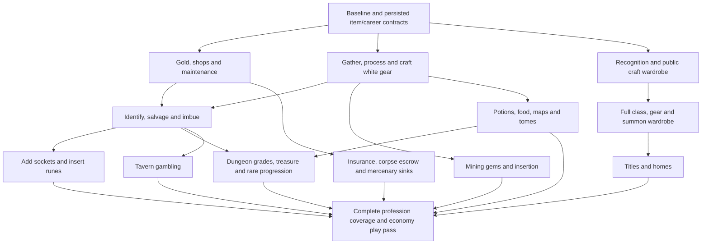

# Crafting, loot and progression implementation roadmap

Created 19 October 2026 (JST). This is a dependency-ordered TODO list for small, playable changes. **T00–T30 are complete for their recorded scope; T02 remains bounded to its reference cohort and T08 excludes ten exotic material recipes by user decision.** T01 verified the comparison build, T02 authored reference evidence, T03 implemented/tested cosmetic class names, and T04 versioned gear state and preserved it across native item paths. T05 adds confirmed profession selection, activation and training behind a disabled-by-default release flag. T06 adds the first tool transaction cohort and registered public town facilities under the same release flag. T07 adds canonical material weights, generic charge-free scrap processing and atomic direct native material conversions under that flag. T08 adds tiered white-equipment recipes, quality, sockets and one-time maker/durability perks. T03–T09 are deployed and the completed profession/crafting features are enabled; see the [cumulative deployment](deployment-t01-t09.md). See the [baseline](t01-working-baseline.md), [reference cohort](t02-reference-cohort.md), [class-name implementation](t03-class-names.md), [item-state implementation](t04-item-state.md), [profession implementation](t05-professions.md), [shared crafting implementation](t06-crafting.md) and [material processing implementation](t07-processing.md). See the [ordinary white-equipment implementation](t08-white-bases.md) and [full recipe book](t08-recipe-book.md). [T09](t09-effective-gear.md) activates effective gear/material stats, broken-gear handling and FHR. [T10](t10-rewards.md) implements and deploys shared reward-life claims, manual D2-derived corpse gold and Gold Find. [T11](t11-vendors.md) implements and deploys persistent equipment stock, sale quotes, supplies and trainers across Britannian towns. [T12](t12-repairs.md) implements and deploys full resource-based repairs, NPC services and working-wand recharge. [T13](t13-death-gold.md) implements and deploys flat20% recursive backpack-gold death loss, aggregate downward rounding and a saved once-only corpse claim. [T14](t14-recognition.md) implements and deploys permanent recognition/wardrobe/housing rights, both named certificates, one bookshelf wardrobe and second-ceremony5,000gold active-class respec. [T15](t15-wardrobe.md) implements free public craft switching after either ceremony, preserving native training and all class/gear/summon/pool/timer state. [T16](t16-salvage.md) moves salvage onto matching production tools with no skill/use/gold cost, guarded destructive contents and preserved independent recovery rolls. [T17](t17-imbuing.md) implements and deploys tiered Imbuing, training checks and five jewellery grades. [T18](t18-identification.md) implements and deploys single-use Identify scrolls, supply and hidden-property boundaries. [T19](t19-gear-drops.md) implements and deploys the mapped Normal drop cohort and active numeric/material MF. [T20](t20-sockets.md) implements and deploys empty-socket creation, tool bonuses, destructive failures and free intuition with an explicit paid retry/safe abort choice. [T21](t21-moulds.md) implements and deploys known-stat moulds with independent ordinary drops and source affix-frequency weights. [T22](t22-runebark.md) adds Runebark harvesting and purchase-only resale. [T23](t23-runes.md) implements the declared rune through Inscription, with exact inputs, separate quality gates and guarded native crafting transactions. [T24](t24-gems.md) implements mining gems, saved quality effects and upgrades. [T25](t25-rune-sockets.md) implements permanent rune installation, working bonuses and filled-socket requirements. Both are deployed. [T26](t26-gem-sockets.md) installs permanent mixed gem/rune sockets and activates all family/quality/slot effects. [T27](t27-timed-effects.md) adds shared timed effects, real-time offline/downtime advancement and independent potion/food/map slots. [T28](t28-alchemy-restoratives.md) adds four guarded restorative mixtures, D2 double-restoration chances and ordinary potion loot. [T29](t29-combat-potions.md) adds the five guarded combat recipes and active speed, damage, leech and mitigation consumers. [T30](t30-cooking.md) adds18 economical meals, one-hour food consumers and the agreed harvest/aggro rules. T31 is the next recommended card.

**Current delivery direction:** the user wants the complete agreed game, not an MVP. Finish known subsystem requirements and consumers; cards remain a dependency/work organization tool. The user explicitly requested deployment and activation of all completed T01–T09 work, superseding the earlier profession release hold. See the [cumulative deployment](deployment-t01-t09.md).

The user requested incremental delivery after completing the questionnaire. All ten crafting professions remain in scope; the earlier A01 instruction to implement them all together is superseded as a delivery strategy. The ordering below is an implementation recommendation, not a change to the agreed mechanics or provisional values.

## Start from a cold session

1. Read applicable `AGENTS.md` instructions, [README](../README.md), this document, [crafting decisions](crafting.md), and [wardrobe progression](wardrobe-progression.md). Read only the relevant sections of the [decision tracker](economy-open-questions.md) and [reconciliation](economy-reconciliation.md) for the selected card. User confirmations after the questionnaire take precedence; the original [replies](economy-open-questions-replies.md) are preserved as evidence, not an editable work list. Root `sanctuary-economy.md` and `sanctuary-crafting.md` are historical drafts.
2. Inspect `git status` in the root and both submodules. Existing dirty changes are substantial, intentional project work. Check the selected source, patch and installed runtime before changing anything. Source code, built output and the running installation can differ. Do not reset them or run setup to clean them up.
3. Pick **one ready card**: all its dependencies must be satisfied in the working implementation, and its blocking choices must be settled or explicitly deferred with the dependent feature left disabled. An independent branch need not wait for unrelated gem, wardrobe or housing choices. The table order is a suggested sequence, not a command to execute every card.
4. Write the bounded scope and acceptance checks before implementing. For a large recipe/content card, choose one representative cohort, complete its loop, then add separate checklist entries for the remaining cohorts. A GM kit may test behavior but is not production acquisition.
5. Implement, run the relevant checks, test the actual client interaction, save/restart, and update the card's evidence and limitations. Distinguish automated fixtures, your own play observations and player feedback. Deployment is a separate operational step; a successful build does not mean the change is installed.

### What already exists

These are the documented comparison baseline, not freshly retested claims for this roadmap. Recheck them in T01. [Economy](economy.md), [XP](creature-experience.md), [creature profiles](creature-profiles.md), [movement](movement-smoothness.md), [melee](melee-reach.md), [reactions](monster-reactions.md), [recovery](hit-recovery.md) and [belt](potion-belt.md) contain the detailed evidence.

| Area | Existing behavior to preserve / adapt |
| --- | --- |
| Movement/combat | Bounded held steering and release, responsive pursuit, dagger/halberd reach comparison, strict impact checks, attack/cast deadlines and player/monster hit recovery. Do not undo the held-movement hang fix or add unbounded path requests. |
| Progression | D2 character XP curve to 99; common reviewed monster XP and pet-owner credit. Persistent spent-life flags prevent revived corpses giving XP again. Current populations remain Normal; persistent Nightmare/Hell variants and their matching stats/XP/loot are available for explicit spawning, with placement deferred. Current profile level ceilings do not provide level-99 dungeon content. |
| Gear | Converted bases, stored random affixes, origins and implemented numerical combat effects. An advertised reference stat is not proof its effect exists. Most talent effects, MF, leech and many elemental/binary effects need further consumers. |
| Economy prototype | Variable physical/essence salvage and white-base Imbuing exist. The installed skill-free 100 gold/5 essence Imbuing and old resale caps are superseded targets, not the new spec. Vendor-origin conversion exclusions and stale-quote/capacity protections must survive. Ordinary wild monster loot is suppressed. The native origin enum has Drop/Vendor/Crafted; gambling should use loot eligibility, not ordinary vendor-stock eligibility. A separate Gambled enum is not an established requirement. |
| Consumables | Real persistent four-column tabard belt, overflow/death handling, forced Enter-to-chat, 1–4 hotkeys, restorative heal/mana behavior and 20% bottle recovery. Production recipes/drop supply and the new buff catalogue are pending. |
| Careers/world | One saved class per character; independent multi-class histories and craft activation are absent. Native skills, crafting/harvesting and a small Britain test neighborhood exist. Full world population, dungeon progression, wardrobe, housing progression and new death economy are pending. |

### Source ownership and entry points

Paths below are relative to the repository root. Start with these owners and follow their call sites; do not add a second authoritative model for the same state.

| Label used in cards | Existing entry points |
| --- | --- |
| Career | `src/Sanctuary.Content/CharacterProfiles.cs`, `ClassCreation.cs`, `ClassSkills.cs`, `ClassStats.cs`, `TalentGump.cs`; `shared/TradeSkills.cs`, `DiabloClass.cs`, `ClassGumpProtocol.cs` |
| Gear | `src/Sanctuary.Content/GearProfiles.cs`, `EquipmentBalance.cs`, `AffixBalance.cs`, `ClassGear.cs`, `ClassCombat.cs`, `ActionTiming.cs`; `data/Sanctuary/Balance/` |
| Economy | `src/Sanctuary.Content/EquipmentEconomy.cs`, `EssenceGump.cs`; `data/Sanctuary/Balance/economy.json`; `patches/ModernUO/0010-persist-item-origins.patch`, `0013-vendor-resale-price-hook.patch` |
| Rewards | `src/Sanctuary.Content/ClassLoot.cs`, `CreatureExperience.cs`, `CreatureProfiles.cs`; [reward roster](creature-reward-roster.md); `tools/build_creature_profiles.py` |
| Production | `upstream/ModernUO/Projects/UOContent/Engines/Craft/`, `Engines/Harvest/`; `src/Sanctuary.Content/CraftTransactions.cs`, `CraftFacilities.cs`, `CraftToolProfiles.cs`, `ProfessionPractice.cs`; native tools, resource items and vendor stock under `Projects/UOContent/`. Follow the production/repair tool handlers, not only a new menu. |
| Effects | `src/Sanctuary.Content/PotionRestoration.cs`, `PotionBelts.cs`, `PotionBeltNetwork.cs`, `PotionTabards.cs`, `HitRecovery.cs`, `ClassStats.cs`, `ClassCombat.cs`, `ClassGear.cs`; `shared/BeltProtocol.cs` |
| Death/followers | `src/Sanctuary.Content/ClassDeath.cs`, `PersistentMinions.cs`, `SkeletonPets.cs`; native PlayerMobile, corpse, banker, pet/mercenary and insurance handlers in UOContent |
| Maps | `upstream/ModernUO/Projects/UOContent/Items/Maps/TreasureMap.cs`, `Items/Skill Items/Fishing/Misc/MessageInABottle.cs`; native Cartography/treasure/Fishing call sites |
| Client | `upstream/ClassicUO/src/ClassicUO.Client/Game/UI/Gumps/` (creation, shop, class and belt interfaces); `patches/ClassicUO/`. Native shop already has serial-based tooltips. |
| Reference/verification | `tools/fetch_balance_sources.py`, `tools/build_foundations.py`, `tools/reference/uo-equipment-layers.json`; `tests/Sanctuary.Integration/`, `tests/check_britain.py`, `tests/test_*.py` |

Keep game logic in project content/UOContent where appropriate; consult ModernUO's own instructions before edits. Native modifications must remain reproducible through the existing patch workflow. Do not rebuild unrelated gear/XP catalogues to author one recipe. Ignored local caches and chat handoffs are supplementary, never the sole specification or required cold-start evidence.

## Dependency map and playable milestones

This graph groups work. Each card below lists its actual prerequisites. A blocked optional branch must not stop another complete loop.



| Milestone | Player loop / comparison | Required cards (including their dependencies) |
| --- | --- | --- |
| M1a: funded outing | Kill → manual corpse gold → loot/sell → buy supplies/bank → save/relog. Keep gear drops disabled until their own card. | T10, T11, T13 |
| M1b: maintain ordinary gear | Gather/hunt → process → craft white gear → equip/fight/wear → player or NPC repair → save/relog. Unlock and switch craft at the public wardrobe through the specified progression route. | T05–T09, T12, T14, T15 |
| M2: magic economy | Find gear → identify or sell unidentified → salvage materials/essence → imbue a white base → equip/use the rolled effect → repeat. | T16–T19 |
| M3r: rune economy | Kill a level-appropriate monster → obtain a known-stat mould → gather bark → commission/craft rune → risk extra sockets → permanently insert → meet requirements/use the effect. | T20–T23, T25 |
| M3g: gem economy | Mine a gem → upgrade if desired → socket → use the actual slot-dependent effect, or sell for the specified pittance. | T24, T26 |
| M4: preparation | Buy/gather ingredients → craft potion/meal/map/tome → use inventory/belt as applicable → fight/gather/treasure hunt → expire/consume → replenish. Carpenter furniture/kegs support the same town loop. | T27–T34 |
| M5: advanced PvE | Enter adapted dungeons → fight graded encounters → find maps/rare recipes/chitin/Power Scrolls → improve craft cap/max durability → return for higher-tier work. | T35–T38 |
| M6: career/home progression | Earn recognition → use public wardrobe → develop another class → save gear/bindings/summons → swap/relog → optionally display earned titles/acquire a home. Profession-only access is already M1b. | T39–T42 |
| M7: complete economic outing | Prepare → kill/loot/gather → craft/trade/gamble → die/recover/insure/resurrect companions → pay upkeep → compare net gold over 30 minutes. | T43–T48 and preceding relevant loops |

M1b is a **release bundle**, not one implementation change: do not ship craft locking without the earned public switching route. M3r can finish while gem-family choices remain open. Rare skill-120 recipes and caps require production acquisition in M5; testing them through a kit does not complete that progression.

## Work cards

Dependencies refer to completed behavior, not just documentation. Spec IDs resolve in the [tracker](economy-open-questions.md); exact numbers/recipes belong in [crafting.md](crafting.md) and versioned balance data, rather than being copied inconsistently into every card. Unresolved decisions are gates only for the behavior they affect. No unchecked card is authorization to invent an answer.

### Foundations and the first maintenance loop

- [x] **T00 — Reconcile decisions and publish this roadmap.**
  - Depends: none. Owners: repository documentation. Spec: A–Q.
  - Done: preserve replies, distinguish target/prototype/recommendations, index remaining choices, define bounded tasks and acceptance checks. This does not complete any runtime card.

- [x] **T01 — Re-establish the working baseline.**
  - Depends: T00. Owners: Reference/verification, README, current implementation reports.
  - Record source/patch/runtime revisions, running processes and existing test outcomes without installing anything. Inspect current save versions, skill values, origin tags, reward-life flags and live/test separation.
  - Accept: one disposable save/restart baseline, relevant current checks and a written list of actual differences from the table above. Preserve the current player/accounts/progression and control preferences. Use the operational notes below.
  - Completed 19 October: [source/patch/runtime inventory, persisted-state findings, commands, passing checks and limitations](t01-working-baseline.md). Combined server/economy and full combat/timing/loot client suites each passed four disposable boots; a copied installed save preserved existing profiles, native skill values/caps/locks and gear across restart. Live gameplay/configuration/preferences were preserved; nothing was deployed. The retained player Focus 5.1 and absence of a selected-craft state are recorded for later migration work.

- [x] **T02 — Author the first bounded reference/catalogue cohort.**
  - Depends: T01. Owners: Gear, Production, Reference/verification. Spec: A/B/E/G/H/M/N.
  - Record pinned D2 evidence/units and map a representative UO weapon, shield, helmet, chest, jewellery and each physical material. Identify supported versus missing stat consumers; distinguish base tier, item level, required level and monster difficulty/grade. Extend catalogues per later card, not through a speculative universal rewrite.
  - Accept: every first-loop item has an explicit maker/material/base tier and legal effects; source facts and adaptation choices are separate. No silently enabled Set/Unique, proc or binary effects.
  - Completed 19 October: [eight-base/five-material cohort, pinned facts/units, maker/tier mappings, exact legal-affix queries and gates](t02-reference-cohort.md). Actual runtime APIs passed 24 pool queries and 1,536 validated seeded rolls; four disposable save/restart boots and all 12 Python checks passed. Remaining recipe/tier/material/jewellery/reward cohorts are listed separately in the report. No gameplay, migration or deployment change.

- [x] **T03 — Apply cosmetic class names for either creation sex.**
  - Depends: T01. Owners: Career, Client. Spec: [class names](class-talents-and-trades.md).
  - Use existing seven identities with the confirmed Gargarean/Amazon, Sorcerer/Sorceress, Druid/Druidess aliases and four unisex names.
  - Accept: creation, paperdoll, talent/wardrobe labels and reload agree; class IDs, XP/talents and combat behavior are unchanged.
  - Completed 19 October: [shared mapping, alias-aware paperdoll formatting, level/reload/talent/speed labels and client patch 0020](t03-class-names.md). All 14 server creation/sex cases and persistence checks passed; real client toggles/Back/reselection and Sorcerer/Druidess world-entry labels were verified. The wardrobe has no UI yet and must use the shared helper in its own card. Matching builds are tested, not deployed; IDs/talent keys/save formats and live progression remain unchanged.

- [x] **T04 — Extend persisted item state for its next consumers.**
  - Depends: T02. Owners: Gear, Economy. Spec: B/E/F/M.
  - Add/version only needed metadata: base tier/material, quality/creator/durability, native versus tinker-added sockets and later sale/identification state. Preserve real item identities and origin exclusions; use deterministic documented legacy defaults, not random rerolls on reload.
  - Accept: old/new saves round-trip; trade/stack/split/copy paths cannot launder origins, lose socket provenance or regenerate random values. Starter/vendor protections survive.
  - Completed 19 October: [version-1 fields, deterministic version-0 defaults, native material/maker/wear ownership, copy/split/stack patch and Imbuing guards](t04-item-state.md). Eight bases/32 saved identities passed accepted/cancelled trade, copy/split and legacy/new save-restart checks. The actual client economy flow, copied installed-world upgrade, 24 affix-pool queries/1,536 seeded rolls and all 12 Python checks passed. No recipes, socket insertion, new sale prices, identification UI, higher-tier mappings or durability bonuses are enabled; these remain their own cards. Matching server/content builds are tested, not deployed.

- [x] **T05 — First profession, skill activation and training.**
  - Depends: T02. Owners: Career, Production. Spec: A02–A04, Q01/Q08/Q09.
  - Store the selected craft and a distinct first-choice-confirmed state; new characters display Alchemy initially. First crafting-tool use asks confirmation before crafting, gains or costs; cancel leaves the choice open. Confirm locks that profession until earned wardrobe access. Gathering tools are exempt. Cartography joins the ten selectable crafts; all three gathering skills stay active.
  - Enforce the chosen craft server-side through applicable native tools/action/gain entry points, not just one gump. Implement paid training to30, the chosen practice bands to70 and cap storage. Use the confirmed T05 migration, crafting-only practice curve and trainer prices; preserve native per-skill caps/locks without aggregate-cap loss. Preprocessing/salvage exceptions follow C and Q10, not a blanket ban on every tool action.
  - Accept: confirm/cancel/repeated/stale prompts, alternate tools, relog and normal gameplay cannot change the locked choice or consume costs on cancel; inactive crafting cannot gain/produce via another menu. Gather/butcher exceptions work. Release with T14/T15, not as an isolated permanent lock.
  - Completed 19 October: [confirmed six decisions, selected-craft persistence, native action/gain/payment guards, trainer pricing and forty practice bands](t05-professions.md). Ten craft choices/all thirteen trainer skills, actual client cancel/confirm/practice, four-boot persistence, the comparison regression and copied-world upgrade passed; all12 Python checks passed. Cartography joins Crafting. Native values/caps/locks and live state are preserved. Feature defaults to disabled and is not deployed; keep it disabled until T14/T15 provide earned public switching. Trainer/tool stock/placement, production recipes and new processing rules remain later cards.

- [x] **T06 — Shared crafting/tool/station rules for the first recipes.**
  - Depends: T04, T05. Owners: Production, Economy. Spec: A05–A08, Q10.
  - Reuse native craft transactions; adapt tool charges, quality roll after success, material selection, target validation and town station requirements. Include explicit portable exceptions, concurrent station users, zero station fee and recipe-unlock storage. Settle remaining tool mappings/charge handling for the selected recipes.
  - Accept: success/failure/cancel/full pack/stale target/relog use the correct resources/charges once; vendor and crafted tool capacities/charge-saving differ correctly. No gains or costs from a rejected request.
  - Completed 19 October: [ten guarded native tool recipes, version-0 tool metadata, configurable10gold/20–30-use vendor tools and100/110/120-use crafted tools,10% saving, public Britain facilities and native recipe unlocks](t06-crafting.md). Four disposable save/restart boots, actual client menu/cancel/full-pack/disconnect checks, all11 usable town station objects, comparison regression, copied installed saves and all12 Python checks passed. Patch reproduction:16 ModernUO/22 ClassicUO patches,36 paths each. Tool completion is the bounded cohort; equipment recipes and full supply remain later cards. Disabled by default, tested and not deployed.

- [x] **T07 — Gather, skin and preprocess ordinary materials.**
  - Depends: T06. Owners: Production. Spec: B03/B05/C01–C04.
  - Implemented/tested, not deployed: approved raw2→processed1→ten generic scraps0.1 model, native ore-size yields, light cloth exception and existing-stack normalization. Portable no-charge quantity/all/cancel processing works without craft selection; one matching active-craft native gain check through30. Direct native smelting/cutting/spinning/loom delivery is atomic. Preserve gathering definitions/species/skill-free skinning; block new bandage cutting and forbidden NPC resource/bandage stock/buybacks.
  - Accept: exact subtype/count/weight, stack limits/full packs and vendor supply exclusions work; failed delivery cannot lose inputs or duplicate yields. No NPC metal/wood/leather source is introduced.
  - Evidence: [T07](t07-processing.md), native patch0017, real-client processing and T05/T06 regressions, four saves/restarts including interrupted textiles, synthetic legacy-weight stacks, disabled comparison and a three-boot copy of installed saves. Release flag remains disabled; installed runtime/saves/preferences unchanged.

- [x] **T08 — Craft usable white bases and tools (agreed standard-material scope).**
  - Depends: T06, T07. Owners: Production, Gear. Spec: B01–B11.
  - Implemented/tested, not deployed:201 ordinary standard-material identities across Normal/Exceptional/Elite,603 recipes. All mapped ordinary weapons/shields/head/body/hands/feet/belts and five potion tabards are covered. Native quantities and Normal skill minima rounded up/capped at80, plus explicit analogues. The original18 recipes remain unchanged; tools remain T06. The ten glass/stone/dragon-scale recipes are explicitly deferred by user decision; jewellery remains T17.
  - Material routing, native tool/facility/material checks, four-component atomic inputs, quality89/10/1, empty sockets at100, maker marks and one-time10–20% durability follow the approved model. New bone is Heavy Tailoring; native racial/gender/class restrictions and old comparison identities remain. Recipes requiring120 have at least1% chance at the cap, preventing native smithing's zero-chance boundary while retaining the120 requirement. Potion tabard rows remain independent of tier.
  - Evidence: [T08](t08-white-bases.md), [complete recipe book](t08-recipe-book.md), native patch0018,603 recipes ×3 qualities (1,809 commits), four boots/save/restarts, actual client tier/recipe/next/previous/tooltip/equip loop, unchanged legacy comparison and copied installed saves, exact patch reproduction and12 Python checks. At the T08 checkpoint, coloured rolls persisted without active effects; T09 below activates them; release flag remains disabled and installed files unchanged.

- [x] **T09 — Project effective gear stats consistently.**
  - Depends: T08. Owners: Gear, Effects. Spec: B04/D09/E04/F.
  - Confirmed design and acceptance scope: [T09](t09-effective-gear.md). Cloth clothing/hats are cosmetic except belts/tabards; leather footwear retains stats. Activate cold chill (2 seconds), poison over time (3 seconds total), stacking Verite regeneration and numeric FHR rolls alongside consistent broken-gear handling.
  - Extend the existing gear aggregation for the selected material/affix effects. Broken worn gear contributes zero damage/defense/stats; broken weapons use unarmed attacks. Keep timing/FHR formulas and equipment-change deadlines honest.
  - Accept: equip/unequip/break/repair/relog recompute the same values without double-counting. Each enabled advertised property has a measured combat/stat effect. Leave unsupported properties unavailable until their own consumer is implemented.
  - Implemented, tested and deployed: [T09 evidence](t09-effective-gear.md). Stored material resistance/typed damage,2-second cold chill,3-second non-stacking poison, additive Verite regeneration, FHR rolls, cosmetic cloth hats and durable-item break/repair projections pass. Four-boot gear/crafting/legacy suites, actual client crafting/equip, copied installed saves,24 affix pools/1,536 rolls,12 Python checks and exact19/22 native patch reproduction pass. T10 activates GF; MF and unsupported affixes stay gated.

- [x] **T10 — One reward-life contract and manual corpse gold.**
  - Depends: T02. Owners: Rewards. Spec: M01/M03, existing XP contract.
  - Confirmed scope and source/acceptance contract: [T10](t10-rewards.md). All four decisions approved: complete mapped Normal roster, amount-only equipped Gold Find, dead/distant credited owners retain gold, existing manual loot rights without party splitting.
  - Extract/author the bounded D2-derived gold rolls and common eligibility for XP, gold, gear, moulds, maps and later recipes. Reuse persistent spent-life/revival semantics; reward eligibility must not depend on XP actually increasing (level99/zero-XP cases). Gold stays on the corpse for the loot grid; remove automatic collection explicitly.
  - Accept: player/pet kill, original/revived death, save/restart, full pack and overlapping death callbacks pay each entitlement once. Keep unsupported/native loot suppressed; do not globally turn on UO drops to obtain gold.
  - Implemented, tested and deployed: [T10 evidence](t10-rewards.md). Complete730-type policy coverage (324 eligible), pinned Normal treasure classes, amount-only equipped GF, actual distant poison/dead-owner pet kills, full-pack/manual client looting and repeated corpse/revival claims pass. Installed four-boot cumulative suites, copied live saves and a live save/restart pass; no fixture assembly is installed.

- [x] **T11 — Essential vendors, persistent resale and supply.**
  - Depends: T04, T06, T10. Owners: Economy, Production, Client. Spec: B05/M04–M06/H09.
  - Supply tools/reagents/bottles/ordinary food ingredients/expensive cloth, author trainers, and replace the prototype resale formula with the specified persistent base-tier quote. Apply unidentified10%, starter1gold and no buyback/destruction on sale; preserve origin. Settle vendor-origin resale and meaning of stock level41/70 before enabling affected stock; gem/bark purchase prices activate with their items and vendors never resell them.
  - Accept: reopen/relog/vendor changes cannot reroll a quote; sales consume items/pay once; sold items cannot be repurchased. Verify actual shop OPL delivery without exposing unidentified stats. Do not reapply the old10% multiplier to new quote bands.
  - Implemented, tested and deployed: [T11 evidence](t11-vendors.md). All six defaults confirmed; saved 9 White/3 Magic offers, item levels 41/70, exact displayed-item delivery, persistent tier quotes and original-price vendor refunds, unlimited approved supplies and 476 service sites across 34 town/facet combinations. Installed four-boot cumulative/legacy/actual-shop suites, all thirteen trainers, 16 Python checks, exact 21/22 patch reproduction, copied existing saves and a live save/restart pass. Both characters and all 13 client preference files are preserved; production assemblies only. Prices remain configurable.

- [x] **T12 — Player and NPC repair/recharge.**
  - Depends: T09, T11. Owners: Economy, Production, Gear. Spec: C03/D01–D12/D14.
  - All six defaults confirmed 20 October: [T12 scope and verification](t12-repairs.md). Full repair/floor1, generic scraps1/3/5, all-resource saving, dedicated repair tools/public workshops, NPC backpack resources plus existing fee, and quantity/fill recharge for functioning wands. Chitin/Powder remains T36; later charge-affix and Unique acquisition retain their own consumers.
  - Implement exact processed-material subtype plus rarity essence, resource-saving and max-durability-loss rolls; NPCs need the same resources plus tier fee and skill80 behavior. Recharge-only uses essence and no durability loss, for charge types with real consumers. Settle extra scrap quantities, repair extent/floor, saving scope and tool charge handling.
  - Accept: worn/broken/partly damaged equipment repairs consistently; cancel/stale/insufficient costs cannot partially consume or reroll accepted work. Save/reload max losses. White repair works before new magic drops; repeat magic cases after T17/T19. Tool charges alone never replace material/essence costs.
  - Implemented, tested and deployed: [T12 evidence](t12-repairs.md). All 486 durable recipe identities, all tiers/current rarities and skill boundaries, exact coloured materials, persistent quotes, saving/loss/floor, tool crafting/uses, NPC fees and quantity/combined recharge pass. Installed four-boot cumulative and legacy suites, actual repair/recharge and shop UI, 16 Python checks, exact 22/22 patch reproduction, copied live saves and live save/restart pass. Both characters, shops and all 13 client preference files are preserved; no fixture assembly is installed. Reserved Unique costs and future charge-affix consumers do not enable their acquisition.

- [x] **T13 — Apply the agreed carried-gold death loss.**
  - Depends: T10. Owners: Death/followers. Spec: O01.
  - Replace the prototype level-based curve with flat20% of backpack-carried gold at death, once, leaving bank gold safe and XP unchanged.
  - Accept: rounding/stack handling is documented; resurrection/relog/repeated death callbacks cannot charge twice. Existing corpse/belt/pet recovery still works.
  - Evidence: [T13 implementation/deployment](t13-death-gold.md);40 level/total cases, nested/protected stacks, zero-gold and legacy claims, repeated deaths, four-boot installed cumulative suite, actual client resurrection/recovery and pet reconnect, and live save/restart. Both characters, gear/materials,485 gold stacks and all13 client preference files are preserved.

- [x] **T14 — Recognition and earned wardrobe access.**
  - Depends: T05, T11. Owners: Career, world content. Spec: A03/Q02/Q08.
  - Add class80 OR craft100 eligibility, town-hall message/ceremony, named painting certificate, bookshelf wardrobe award and housing-right flag. Gathering100 does not qualify. Settle unlock ownership, town selection and second-award handling before final ceremony rewards.
  - Accept: both qualifying routes and Cartography work once across reload; gathering cannot unlock it; recognition is not a free house. Award/capacity failure cannot duplicate rewards or lose earned access.
  - Confirmed/implemented: permanent per-character rights; any supported civic hall; the other route grants its second honor/certificate with furniture once. The second completed ceremony unlocks5,000gold respec of the active class only, refunding allocated class skill/stat points while preserving level/XP/trades; success closes the UI and invalidates the wardrobe session, without a combined switch or inactive-template reset.
  - Evidence: [T14 implementation/deployment](t14-recognition.md),22 offices on both facets, all ten crafting routes/all seven respec baselines, pending/replayed awards, actual client ceremony/respec UI and source/installed four-boot suites. Live save/restart preserves both characters, raw attributes/skills/recognition, gear/materials,485 gold stacks and all13 client preference files.

- [x] **T15 — Public wardrobe: first craft-only switching loop.**
  - Depends: T14. Owners: Career, Client. Spec: A03/Q03/Q08.
  - Provide public town-hall access. Opening preselects current class/craft; tick exactly one of each to enable Swap. In this bounded slice the existing class remains selected and other classes await T39/T40. Switching only the craft is free, alive/out-of-combat, and preserves all trained skills. Settle combat/action detection for this operation.
  - Accept: locked/unlocked/dead/in-combat/stale sessions, unchanged selection, craft-only change and relog behave correctly. A craft-only switch does not move gear/summons, refill pools or reset timers. Retain T14 wardrobe-session validation so a successful paid respec invalidates every pending switch/wardrobe response. Deploy with the T05 activation rules so eligible players have a real route to switch.
  - Completed20 October: [public craft-only wardrobe](t15-wardrobe.md) preselects the current class/craft, validates exactly one of each, activates all ten crafts without losing training and rejects stale/remote/combat/action responses. All22 public wardrobes work after either ceremony. Unchanged selections are no-ops; pending trainer/craft transactions cannot cross a switch roundtrip. Respec remains second-ceremony-only and closes/invalidates every wardrobe response. Four-boot persistence, actual ClassicUO switching/respec, cumulative checks and protected copied-world deployment verification pass. No independent class histories or class switch is introduced.

### Magic gear, sockets and gathering socketables

- [x] **T16 — Bring salvage onto the agreed tools.**
  - Depends: T07, T09. Owners: Economy, Production. Spec: C02–C04/P03–P05.
  - Adapt the existing salvage transaction to proper tools, no skill/charge/gold cost, correct physical material and retained independent rarity/ilvl recovery rolls. Filled contents are lost with no extra yield. Keep Unique recovery reserved until real Unique items exist.
  - Accept: Drop/Crafted/Gambled eligible; Vendor/starter/protected rejected, including native salvage/resmelt/scissor/bag bypasses. Confirm/cancel/stale/full-pack and reload do not duplicate resources or destroy the item without delivery.
  - Completed20 October: [corresponding-tool salvage](t16-salvage.md) adds the free action to smithing/fletching/tailoring/tinkering tools; the common menu requires the same real tool. No active craft, skill, use charge, gold fee or town station is required. One-use connection/source/content snapshots reject changed/replaced/reconnected requests; native recycling paths remain blocked. Independent rarity/ilvl rolls, empty results and filled-content destruction retain the agreed rules. Zero-skill/different-craft actual ClassicUO confirm/cancel/reject flow, four-boot cumulative/legacy persistence, Python checks and copied-world deployment verification pass. Unique remains reserved; ten exotic recipes remain deferred.

- [x] **T17 — Tiered Imbuing and white jewellery.**
  - Depends: T09, T11, T16. Owners: Economy, Production, Gear. Spec: E01–E05.
  - Replace skill-free prototype rules with base-tier/jewellery skill/cost ladders and 120 rarity odds; build the ladle/cauldron path. Eligible white weapons/shields/rings/amulets remain included. Persisted native quality sockets are allowed; any tinker-added socket forbids Imbuing even before socket creation goes live.
  - Accept: valid actions always yield Magic/Rare with ordinary eligible random affix values. Cancel/reject never destroys gear; real charged costs and one transaction survive replay/reload. Jewellery ilvl/equip/costs are confirmed in crafting.md; effects require tested consumers.
  - Completed20 October: [T17](t17-imbuing.md) supplies the3 equipment/5 jewellery ladders, ten white jewellery recipes, ladle/cauldron requirements,120 rarity odds and one native gain check per paid transformation. Native quality sockets and all stored identity survive; Tinker sockets forbid Imbuing. All recipes/boundaries/costs, both odds branches, stale/replay paths, jewellery effects, actual client menus/craft/confirm/cancel and save/restart checks pass. Deployed with T18 after protected backup and copied-world comparisons.

- [x] **T18 — Identification and information boundaries.**
  - Depends: T04, T11, T17. Owners: Gear, Economy, Client. Spec: M06, I.
  - Implement persistent identified state and the first real identification route using the selected scroll/tome behavior; establish recipe/vendor supply for the chosen small route. Defer the larger tome ladder to T34.
  - Accept: ground/corpse/backpack/shop/tooltips do not reveal hidden affixes or alter rolls; identification reveals the same stored item, and its quote remains the same underlying price. Unidentified sale pays10% without identifying it.
  - Completed20 October: [T18](t18-identification.md) adds a1BlankScroll+1BlackPearl, Inscription0–50 pen/public-desk recipe and80gold scribe supply. Single-use scrolls reveal only own-backpack gear, consuming only on success; new magical drops are hidden until identified and cannot equip. Existing states/rolls/quotes remain intact. Native labels/wand extras, salvage and repair previews respect hidden state. Recipe/vendor/use/rejection/copy/reload, actual ClassicUO and cumulative/legacy checks pass. Both live saves/restart and pre/staged/post-live character/gear/material/gold equality are verified. Charged tomes remain T34 and encounter gear generation T19.

- [x] **T19 — Bounded production gear drops and Magic Find.**
  - Depends: T10, T17, T18. Owners: Rewards, Gear. Spec: M02/N02/E04.
  - Author the first encounter cohort from verified D2 tables and UO counterparts: counts/chances, item levels, base tiers, rarity and affix eligibility. Implement MF's actual selection consumer before enabling MF affixes. Settle unsupported Set/Unique outcomes rather than silently reassigning their probability.
  - Accept: kill→loot→identify→equip/sell/salvage completes in play; pet/revival entitlement holds. Distribution checks use fixed seeds/bounds, not claims of full D2 parity from a small sample. Do not enable unconverted monsters' abilities/stat profiles as a side effect.
  - Completed 20 October: [T19](t19-gear-drops.md) implements the existing mapped Normal roster with pinned treasure/base weights and quality ratios. Gold and gear share one terminal draw. Unsupported branches and successful Set/Unique rolls remain empty without rerolls; white subqualities produce ordinary white bases. Working equipped numeric/material MF contributes to source quality checks and the client status panel. Seeded boundaries/distributions, every mapped variant, native death/pet/revival, item lifecycle and four-boot save checks pass. Installed cumulative/client checks, both live saves/restart and pre/staged/post-live preservation comparisons pass. The user subsequently requested [Nightmare/Hell variants](t19-difficulties.md), with matching numeric stats/XP/loot and deferred placement. Distinct dropped-white quality bonuses, actual Set/Unique identities and graded/world-authored encounters remain future work.

- [x] **T20 — Tinkering empty sockets and destruction.**
  - Depends: T17. Owners: Production, Economy, Gear. Spec: F01–F08.
  - Add one socket per attempt using both base-tier and socket-index gates, five cap,100/50/25/5/5% base schedule and permanent tinker provenance. Warn that socketing a white item blocks later Imbuing. Costs are tool charges only; native sockets count toward the next index.
  - Accept: deterministic success/failure paths, destruction/installed-content loss, all gates, cap, cancellation and reload. Crafted Average/High Quality/Superior tools give+1/+2/+3 percentage points; shop/untracked legacy+0. At120, intuition stops before acting with no charge/item change, then offers safe abort or one paid retry with ordinary saving; no recursive intuition.
  - Completed20 October: [T20](t20-sockets.md) implements the configured gates/odds/cap, guarded native tool flow, permanent provenance and white-item warning. Source and installed four-boot suites, actual client buttons, existing Imbuing/Identify/tool-crafting flows, separate legacy migration, both live saves/restart and copied-world preservation checks pass. Rune/gem insertion remains T25/T26.

- [x] **T21 — Known-stat mould catalogue and ordinary drops.**
  - Depends: T02, T10, T19. Owners: Rewards, Gear. Spec: G01/G03/G04/G06/G09.
  - Define eight tiers, percentage-only legal stat mappings, category minimum baselines and canonical suffixes. A mould declares its stat before crafting. Add ordinary0.1% drops; reserve the grade field for T35's1/5/10% encounters.
  - Accept: level bands/stat/tier/names persist through trade/reload; no flat/binary rune, old random-stat craft or universal1–8% assumption returns. The same spent-life contract prevents repeat moulds.
  - Completed20 October: [T21](t21-moulds.md) defines120 persistent identities across eight tiers and15 working percentage families. User chose one separate0.1% roll for one mould, unaffected by MF, and Diablo affix-frequency weights. Source/installed four-boot cumulative and actual-client kill/tooltip/pickup checks, separate legacy migration,24 Python checks, both live saves/restart and exact copied-world preservation comparisons pass. Current roster caps at85; T8 natural supply and higher encounter grades remain T35.

- [x] **T22 — Runebark harvesting and resale.**
  - Depends: T07, T11. Owners: Production, Economy. Spec: H01/H03/H04/H09.
  - Add one5% roll per successful wood harvest using trained Base skill and eight45–80 thresholds; random unlocked tier and find message. Author quantity/distribution/full-pack handling before enabling. No bark upgrades or NPC/monster supply.
  - Accept: no byproduct on failure or per-tier extra rolls; skill bonuses cannot bypass Base thresholds. Higher bark may substitute downward later. Correct10–80 vendor purchase price, no resale stock.
  - Completed20 October: [T22](t22-runebark.md) supplies eight persistent stackable tiers, one piece per5% roll, uniform unlocked-tier selection and full-pack placement at feet. Trained Base thresholds, native extraction failures, split/trade/reload identity, partial vendor sales and absent buyback stock are covered. Source/installed cumulative, legacy, actual-client and24 Python checks pass; installed and copied-world preservation are verified. Deployed with live save/restart checks. Rune crafting remains T23.

- [x] **T23 — Inscription makes the declared rune.**
  - Depends: T06, T21, T22. Owners: Production, Gear. Spec: G01–G05/G08.
  - Consume one mould, tier1–8 bark quantities and one pen charge; skill30–100, quality+10/+20 gates and separate rune odds. Higher bark substitutes downward without raising the output tier/stat. Apply category-minimum+(tier−1)+quality points.
  - Accept: Average/HQ/Superior boundary cases including SuperiorT8 at120, costs/cancel/full-pack/reload and naming agree. Ordinary gear affix rolls keep their random ranges; rune baseline minima do not flatten gear.
  - Completed20 October: [T23](t23-runes.md) supplies eight rune recipes and360 tier/stat/quality outputs from frozen mould identities. User confirmed native requirement→+50 success/gain bands and failure loss of mould, half bark rounded up and pen use. Source/installed four-boot cumulative,720 saved identities, client target/cancel/confirmation/native timer, legacy,24 Python and copied-world checks pass. Deployed with live save/restart preservation.

- [x] **T24 — Mining gem families, quality and upgrades.**
  - Depends: T07, T11. Owners: Production, Gear, Economy. Spec: H01/H02/H05–H09.
  - Add nine families/five qualities at Base40–80, one5% roll per successful ore harvest and purchase-only prices. Legacy gems are decorative. Resolve family→D2 mapping, second added flat stat, family/quality quantity weights, capacity behavior and upgrade recipe/ratio/profession before enabling the relevant outputs.
  - Accept: no vendor/monster usable-gem supply; upgrades preserve identity rules and consume once; actual stored effects differ correctly by quality. Keep the L08 treasure exception unresolved until explicitly answered.
  - Completed20 October: [T24](t24-gems.md) supplies all45 identities, typed ore-only5% finds, nine-family mapping, confirmed Star Sapphire MDR1–5, decorative legacy gems and36 guarded upgrades. One piece/uniform family and unlocked quality/full-pack feet plus guaranteed3:1 public Tinkering40–70 upgrades are authored starting defaults. Source/installed cumulative and legacy suites, actual-client mining/upgrade flow,26 Python checks and copied-world preservation pass; deployed with full backup and saved live restart. Gem effect activation remains T26.

- [x] **T25 — Permanent rune insertion and equipment requirements.**
  - Depends: T20, T23. Owners: Gear, Economy, Client. Spec: F06–F08/G07.
  - Fill sockets permanently, add numeric bonuses once and enforce filled-count level30/40/50/60/70 alongside base/affix/attribute requirements. Empty sockets add no level requirement; rune identity adds none. No extraction/replacement.
  - Accept: insertion/equip/unequip/break/repair/trade/relog give identical totals; failed/stale requests cannot duplicate runes. Five FHR runes affect the actual recovery consumer, without changing movement/attack timing through a second path.
  - Completed20 October: [T25](t25-rune-sockets.md) installs frozen rune identities once, for the rune alone, with guarded backpack target/confirmation, all15 working stat families and level30/40/50/60/70 floors. Cross-slot damage/defense, actual five-rune FHR, copy/transfer/reload, break/repair and unchanged salvage yield pass. Gear statev4 migrates older states to empty contents without changing prior fields. Source/installed suites, actual-client cancel/confirm/equip checks and protected live-world restart pass.

- [x] **T26 — Gem insertion and real slot-dependent effects.**
  - Depends: T24, T25. Owners: Gear, Effects. Spec: H05/F06–F08.
  - Reuse insertion/requirements and implement the mapped D2 weapon/shield/armour differences; the two extra flat effects are slot-independent as agreed.
  - Accept: each of nine families has real measured effects in supported host categories, no inert tooltip-only bonus. Permanent loss and save/equip aggregation match runes.
  - Completed20 October: [T26](t26-gem-sockets.md) activates all45 identities across four supported hosts, with shared permanent insertion/count/level rules. Elemental/poison/chill damage, undead damage, physical leech, melee reflection, pre-resistance flat magic reduction and native regeneration consume frozen gem values. Version5 preserves existing runes and migrates empty gem contents. Source/installed cumulative and legacy suites,180 host cases/360 saved copies, actual-client mixed insertion/cancel/tooltip,26 Python checks and protected live-world restart pass. Timed-effect persistence remains T27.

### Consumables, convenience crafts and exploration

- [x] **T27 — Timed-effect persistence and stacking contract.**
  - Depends: T09, T15. Owners: Effects, Career. Spec: J/K/L/Q04/Q06.
  - Agree owner scope/shared versus per-class and offline/inactive-time behavior before binding potion/food/map state. Reuse existing restorative timing where suitable; add only the common expiry/reapplication behavior needed by the next consumable.
  - Accept: reload/reconnect/expiry and later class-switch hooks cannot refresh duration, double effects or cleanse damage. Potions extend duration up to90s, food/map categories each permit one effect. User confirmed one potion-buff slot, independent of the one food slot; map remains independent.

  - Completed20 October: [T27](t27-timed-effects.md) persists character-owned temporary effects, chill/poison fractions and unfinished healing/mana lanes. All advance offline/during downtime and clear on death. Same potion extends30s up to90s; another replaces30s, food/map reset1hour/30minutes. Reconnect/craft changes settle elapsed state without resets. Future consumable recipes/effects remain their own cards.

- [x] **T28 — Alchemy restoratives and normal potion supply.**
  - Depends: T06, T11, T19, T27. Owners: Production, Effects, Rewards. Spec: J03–J05/P09/P10.
  - Verify existing D2 restoration/class behavior against selected data, add the chosen heal/mana drop mapping, unlimited NPC stock through Greater, Super drop-only and crafted rejuvenations/instant heal/mana recipes. Preserve existing inventory and belt consumption/bottle handling.
  - Accept: actual crafted/bought/dropped potions work from both sources; 20% bottle recovery/full-pack behavior, mixed-tier healing and1–4/Enter-to-chat controls remain correct. Rejuvenations never enter monster drops.

  - Completed20 October: [T28](t28-alchemy-restoratives.md) verifies the ten pinned class-scaled restoration profiles/prices, activates existing hp/mp terminal loot across three difficulties, and adds the four50/60/70/80 Alchemy mixtures. User-approved double restoration freezes one effective Vitality/Energy roll per ordinary dose. Exact inputs, one output, rounded half-each failures, mortar saving, native timer/gain, instant pool handling, inventory/belt and persistence are covered. Rejuvenations remain craft-only; other reserved loot stays empty.

- [x] **T29 — Alchemy combat buffs and their effect consumers.**
  - Depends: T28. Owners: Production, Effects, Gear. Spec: J01/J02.
  - Completed20 October: implemented and deployed the five recipes, exact user-approved5/10/10/15/20-per-reagent costs and guaranteed Protection120. Spell additions are10% original damage per element; Protection subtracts10 once after mitigation. See [T29](t29-combat-potions.md).
  - Accept:30s→at most90s duration stacking without magnitude growth, exact resource/output counts, damage/healing/mitigation order and expiry/reload. Speed buffs preserve bounded steering, collision, hit recovery and constant turn speed.

- [x] **T30 — Cooking meals and gathering/corpse hooks.**
  - Depends: T07, T22, T27. Owners: Production, Effects, Rewards. Spec: K01–K05.
  - Implemented18 named meals across the three bands, native ingredients/portion-aware flour and5/10/30chips, fixed effects and one-hour shared food state. Active radial light/capacity, primary gathering quantities/speed, corpse yields and first-acquisition delay; retained+74 capacity. User confirmed1s harvest floor and10s continuous absence to reset aggro delay, with immediate retaliation. See [T30](t30-cooking.md).
  - Accept: use/replace/expire/relog work; leaving capacity buff applies normal encumbrance and the **player manually drops** items. No automatic spill, multiplied byproduct rolls, repeated skinning bonus or zero-time gathering loop.

- [ ] **T31 — Carpenter furniture, stations and kegs.**
  - Depends: T06, T07, T28. Owners: Production, Effects. Spec: A/B05/Q10.
  - Adapt useful native furniture/keg recipes into the progression. Tinkering remains the producer of tools. Town crafting starts free; making home furniture does not approve private crafting stations. Inspect compatibility of native keg transfer with custom potion identity before enabling it.
  - Accept: real crafted objects persist/place safely; keg transfers cannot change potion tier/effects, duplicate bottles or bypass belt/storage limits. No unrequested automatic refill system.

- [ ] **T32 — Crafted consumable map buffs.**
  - Depends: T06, T19, T27. Owners: Maps, Production, Effects, Economy. Spec: L01–L05.
  - Implement city/world/dungeon map recipes, one map effect for30min, independent of maker skill on use. Resolve purchase/sale/both for city5% and whole-dungeon versus floor exit boundaries before enabling those effects.
  - Accept: double-click consumes once; search radius/MF/vendor consumers actually change, dungeon exit expires the correct effect, and relog cannot reset duration. Cartography action/gains respect the chosen-craft rules; consuming a finished map does not require its maker's skill.

- [ ] **T33 — Shared level-one Teleport effect and scroll targeting.**
  - Depends: T09, T27. Owners: Career, Effects, Client. Spec: I04.
  - Implement/verify the actual Sorcerer/Sorceress level-one Teleport effect with source-backed range, collision, elevation and timing. Use the same validation for a single-use scroll: inventory right-click targets normally, belt use takes cursor world position.
  - Accept: walls/doors/corners/stairs, invalid targets, cursor outside world, death/recovery and repeat requests cannot clip, duplicate or consume incorrectly. No need to implement all other talent effects first.

- [ ] **T34 — Scrolls, consumable tomes and bonus Teleport output.**
  - Depends: T18, T23, T33. Owners: Production, Effects, Client. Spec: I01–I04.
  - Author TP/Identify recipes/supply and3/4/5/6/7/10 tome charges at50–100, quality+1/+2 and no refill. Settle vendor capacities/prices. Full-tome craft at100 has1% extra single-use Teleport scroll using T33, not an inert item.
  - Accept: consumption/last charge/cancel/full pack/belt interaction/reload and quality thresholds; no old20-charge/charge-saving tome rules or refill loophole.

### Advanced rewards and character progression

- [ ] **T35 — Encounter grades and higher-level dungeon profiles.**
  - Depends: T19, T21. Owners: Rewards, creature AI/profile content. Spec: G06/G09/M02.
  - Confirmed world direction (20 October 2026): Trammel supports Normal/Nightmare mobs above ground; Hell mobs there are restricted to dungeon floor 3. Felucca supports Hell mobs in the open world, providing additional high-level areas. Specific outdoor spots, dungeon layouts and populations remain later world-authoring work. This records the planned distribution; the current Normal-only spawns remain unchanged.
  - Author champion/random unique+minions/named super-unique grade semantics and1/5/10% mould chances. Monster grade is distinct from Unique item rarity. Build bounded adapted dungeon cohorts reaching90–99 beyond current ceilings, using creative UO counterparts and verified profiles; no act-boss system is required.
  - Accept: real encounter level, offense/defense/resists/speed/reaction/recovery, converted abilities and rewards agree. Test doors/corners/pursuit and pet targeting. Merely lifting an85 cap is not a balanced level99 monster; the requested [Nightmare/Hell variant infrastructure](t19-difficulties.md) is now separate completed work; this card still owns encounter grades and world placement.

- [ ] **T36 — Chitin and maximum-durability restoration.**
  - Depends: T12, T28. Owners: Rewards, Production, Economy. Spec: D13.
  - Settle eligible species/drop rates, Alchemy processing skill/recipe and Powder of Fortifying restoration amount/floor/ceiling. Hook chitin into T10's reward entitlement, not a second native loot path.
  - Accept: eligible Solen/Terathan/arachnid kill→chitin→powder→restore max→ordinary repair completes. No free refill beyond defined extent, repeat-revival drops or restoration past the permitted maximum.

- [ ] **T37 — Treasure maps, keys and rare recipe acquisition.**
  - Depends: T20, T31, T32, T35. Owners: Maps, Production, Rewards. Spec: L06–L10.
  - Map modern five named tiers to native six-level behavior, author skeleton keys/charges and small adapted dungeon sections. Add1% level-band map drops and20/40/60/80/100% one-recipe rewards, tier3 Cooking/all120 recipes; separate native Fishing/bottle/SOS research from land treasure.
  - Accept: map→decipher/search→key→encounter/chest→learn recipe works with retained skills. No hidden Lockpicking/Remove Trap reintroduction or repeated chest reward. Settle cash/gear/resource quantities and usable-versus-decorative treasure gem exception before enabling those rewards.

- [ ] **T38 — Boss Power Scroll drops and cap unlocks.**
  - Depends: T05, T35. Owners: Career, Rewards. Spec: A03/Q09.
  - Settle profession specificity, owner scope, order/tradability and rare boss weights; apply105/110/115/120 caps without granting skill levels. Use dungeon bosses authored in T35, not unsupported D2 act bosses.
  - Accept: dropped/traded/used scroll, already-unlocked/out-of-order cases, inactive craft and relog preserve the right cap and consume correctly. Both120 recipes and their skill caps have production acquisition.

- [ ] **T39 — Migrate to independent class histories.**
  - Depends: T15, T27. Owners: Career, Death/followers. Spec: Q04–Q08.
  - Settle pool/status/timer ownership, shared backpack/bank/gold/belt/quests/location, first activation gear/bindings and inactive advancement. Migrate the current single class/ranks/allocations into its initial class record without changing IDs or earned progress.
  - Accept: old/new saves preserve all values; two class histories level independently and reload without free healing/cleansing/reset. Migration must be reviewable and recoverable before enabling swaps.

- [ ] **T40 — Full class/gear/binding/summon wardrobe transaction.**
  - Depends: T39. Owners: Career, Gear, Death/followers, Client. Spec: Q03–Q07.
  - Expand the existing preselected two-list UI to all classes. Resolve real-item loadout storage/capacity/lost-item rules and summon suspension/lifetime/follower accounting, including ordinary pets/mercenaries. Move/save real entities; never clone them. Retain free/alive/out-of-combat access and allow normal encumbrance on a weaker class.
  - Accept: class-only/craft-only/both/unchanged choices, stale sessions, invalid gear/storage, active summons, disconnect and reload. Validation failure leaves the prior state intact; only the active class's permitted summon set remains active. Client hotkeys/talents/stats/belt resynchronize without resetting combat deadlines.

- [ ] **T41 — Optional earned titles.**
  - Depends: T14, T39. Owners: Career, Client. Spec: Q11–Q13.
  - Settle exact class99 prefixes/skill100 suffixes, any higher ranks, earned-versus-active selection and legacy/town-hall presentation. Either title slot can be hidden. Gathering100 earns skill-title eligibility, not wardrobe recognition.
  - Accept: independently selected/hidden titles persist across class/craft swaps and reload. Sex aliases remain cosmetic; no stats/notoriety changes. Grandmaster100/Legendary120 is still a recommendation, not an adopted replacement for the user's example.

- [ ] **T42 — Homes, architect/town purchases and personal wardrobes.**
  - Depends: T14, T40. Owners: world/housing content, Career. Spec: O06/O07/Q02/Q10.
  - Author locations/prices and architect placement/town-sign purchase flows gated by recognition, no recurring charge initially. Place the awarded bookshelf wardrobe; settle ownership/house-loss behavior. Public access must remain available without home ownership.
  - Accept: purchase/place/move/sell/loss/reload preserve permissions and real stored property; no free home or unapproved private workshop. Furniture is an access point, not an excuse to erase character progression.

### Remaining sinks, complete coverage and tuning

- [ ] **T43 — Equipment insurance.**
  - Depends: T13, T19. Owners: Death/followers, Economy, Gear. Spec: O03.
  - Settle payment source/duration/renewal/retention and implement the rarity/base-tier price table for supported rarities. Unique prices remain future data until real items exist.
  - Accept: insure→death→recovery/renewal across insufficient funds, equipped/backpack gear, belt, trade and relog; one payment/retention outcome per death. No item duplication or origin change.

- [ ] **T44 — 24-hour corpse escrow and banker recovery.**
  - Depends: T13, T43. Owners: Death/followers, Economy. Spec: O02.
  - Settle content-based fee, exact refusal/no-funds deletion trigger and bank-capacity handling before implementing irreversible deletion. Persist corpse age/escrow ownership; honor insurance and existing pet/belt recovery.
  - Accept: death→24h boundary→escrow→quoted banker recovery, cancel/refusal/no funds/full bank/offline/restart and simultaneous access. Use isolated fixtures for deletion cases; never experiment with live player belongings.

- [ ] **T45 — Tavern gambling.**
  - Depends: T18, T19. Owners: Economy, Gear, Rewards, Client. Spec: N01–N03.
  - Author D2-derived price/item-level/base/rarity generation, offer all intended item families and hidden-stat stock at tavern gamblers. Reuse the resolved unsupported-rarity policy and real item generation; preserve loot eligibility for gambled items instead of tagging them as ordinary Vendor stock.
  - Accept: buy/reveal/equip/salvage/sell loop, refresh/level bounds, hidden tooltips, funds/capacity and save/reload. No origin laundering or previewing the purchased roll for free.

- [ ] **T46 — Mercenary resurrection and healing reserves.**
  - Depends: T13, T28. Owners: Death/followers, Effects, Economy. Spec: O04/O05/Q05.
  - Implement level×1,000 resurrection with retained real gear/inventory. Define drink thresholds, reserve capacity and active-heal behavior; healing-only reserve is not retrievable player storage, with warnings10/5/1/0.
  - Accept: actual companion death→pay→resurrect, insufficient funds, healing use/depletion, logout/reload and follower ownership. Coordinate T40 class switching with Q05; do not assume existing skeleton minions constitute a mercenary system.

- [ ] **T47 — Complete all profession recipe/gain coverage.**
  - Depends: T08, T17, T23, T29, T30, T31, T34, T37, T38.
  - Owners: Production, Career, Reference/verification. Spec: A01/A02 and each profession's sections.
  - Maintain a matrix for **Alchemy, Blacksmithing, Bowcraft/Fletching, Carpentry, Cartography, Cooking, Imbuing, Inscription, Tailoring, Tinkering**. For each, list tools/station, input source, useful outputs every10 points through110, practice/gain bands,100/120 perks, cap access, rare recipe source and product consumer. Mining/Lumberjacking/Fishing get their own always-active progression/source matrix.
  - Accept: finish remaining cohorts individually, including crafted tools/keys/jewellery/furniture, Fishing/SOS and top-end recipe unlocks. A row is complete only when its output has a usable consumer and sustainable acquisition; placeholder recipes/GM grants are insufficient.

- [ ] **T48 — Combined play comparison and economic budget.**
  - Depends: T03, T12, T25, T26, T36, T38, T41, T42, T44, T45, T46, T47.
  - Owners: all affected systems and verification. Spec: M01 and complete loops above.
  - Record30-minute outings by level/gear/class with gold faucets separated (kills/resale/gathering) and sinks separated (repair/consumables/crafting/death/gambling/companions). Include vendor-cloth→crafted-resale paths. Preserve the supplied starting values; propose tuning from results rather than silently reinstating old caps.
  - Accept: sustainable repairs plus intended surplus, usable cross-profession supply, and documented limitations. Exercise sustained movement/CPU/requests, angled runs/turn/release, doors/fences/corners/stairs, melee/cast stops, hit recovery, pet kills/revives, full packs, death and save/reload. No drift/clipping/timing changes or removed control bindings. Full D2 parity is not the acceptance claim.

## Verification and deployment workflow

Use tests appropriate to the selected card, then broaden when shared state changes justify it. Existing fixtures protect the comparison build; new mechanics need meaningful cases for their own behavior, not merely assertions that repeat constants. Documentation-only edits need link/dependency/consistency checks, not rebuilding the game.

From the repository root, inspect these entry points before running them; outputs and dependencies may have changed since this roadmap:

```bash
python3 -m unittest discover -s tests -p 'test_*.py'
./dev build content
.tools/dotnet/dotnet build tests/Sanctuary.Integration/Sanctuary.Integration.csproj -c Debug -o .local/integration --nologo
```

`build content` builds project output, not a live install. If changing UOContent, build the native application against the project overrides without staging it into a running installation:

```bash
SANCTUARY_ROOT="$PWD"
(
  cd "$SANCTUARY_ROOT/upstream/ModernUO"
  "$SANCTUARY_ROOT/.tools/dotnet/dotnet" build Projects/Application/Application.csproj -c Debug --nologo \
    -p:CustomAfterMicrosoftCommonTargets="$SANCTUARY_ROOT/build/ModernUO.targets" \
    -p:NBGV_GitEngine=Disabled -p:WarningsNotAsErrors=NBGV1001 -p:PublicRelease=false
)
```

Build the project content/integration against a matching native binary set afterwards. A useful existing server regression selection is:

```bash
SANCTUARY_TEST_SERVER="$PWD/upstream/ModernUO/Distribution" \
SANCTUARY_TEST_CREATION=1 SANCTUARY_TEST_ECONOMY=1 \
SANCTUARY_TEST_CREATURE_XP=1 SANCTUARY_TEST_CREATURE_PROFILES=1 \
SANCTUARY_TEST_COMBAT=1 SANCTUARY_TEST_PETS=1 \
SANCTUARY_TEST_MONSTERS=1 SANCTUARY_TEST_RESURRECTION=1 SANCTUARY_TEST_BELT=1 \
python3 tests/check_britain.py
```

Select `SANCTUARY_TEST_SERVER` only after verifying that directory contains the intended matching binaries. The harness uses disposable accounts/saves and separate ports. It symlinks some selected binaries/content/data, and currently still obtains configuration from `.local/server/Configuration`; **do not rebuild mapped files while it runs**. This workspace's exFAT volume lacks symlink support: use `/dev/shm` for symlink-based disposable runtimes, or actual copies if creating a test runtime under `.local/`. Run harness sessions sequentially and retain each log separately; the default log name is shared.

For actual client economy checks, use the existing `SANCTUARY_TEST_UI=1`, `SANCTUARY_TEST_COMBAT_UI=1`, `SANCTUARY_TEST_ECONOMY_UI=1` and an absolute `SANCTUARY_TEST_UI_STATE` output path alongside the appropriate server flags. Read `tests/check_britain.py`/`tests/check_economy_ui.py` before adapting them. Current UI fixtures test real gumps/buttons but provide some targets through the normal server target callback; do not claim that proves pixel-based backpack targeting. Add a real manual path for tool use, first-profession confirmation and wardrobe selections.

`./dev setup` is for initial setup, not repairing a dirty existing checkout. `./dev build server`, `./dev build client` and `./dev server` can stage runtime files/content; do not treat them as read-only validation. For a deployment: identify the exact changes, save and stop the live process cleanly, back up relevant runtime/configuration/accounts/saves, install only intended artifacts, restart, and verify identities/progression/items/client preferences. Preserve a concrete rollback and migration record. Never deploy integration assemblies or test kits into production automatically. A content change must not overwrite unrelated client, application/core or gear work.

## Completion record for each card

Append this beside the completed card or link a durable repository report. Keep this roadmap updated as the source of the next ready task.

```text
Card / bounded cohort:
Prerequisites verified / decisions settled (spec IDs):
Changed source, data and upstream patches:
Save migration / legacy defaults / rollback:
Automated commands and outcomes, with durable evidence:
Actual client play observations (and separate player feedback):
Installed artifact/revision, or explicitly not deployed:
Known limitations / remaining cohorts / next ready card:
```

Do not tick an entire milestone because one representative item passed. Mark remaining recipe/encounter/stat cohorts explicitly, and keep unresolved design choices distinct from implementation recommendations. The next recommended implementation task is **T13**. T09 completes effective gear/material projection for T08's agreed standard-material recipe book. The ten exotic recipes remain explicitly deferred by user decision. T03–T12 are tested, deployed and enabled for their completed scope.

Documentation verification on19 October: all49 card IDs are unique, dependencies point to earlier existing cards (no cycles), local Markdown links resolve, the131 questionnaire IDs retain their order, and the replies SHA-256 still matches the [reconciliation record](economy-reconciliation.md). `git diff --check` passed. These checks do not constitute gameplay verification.
